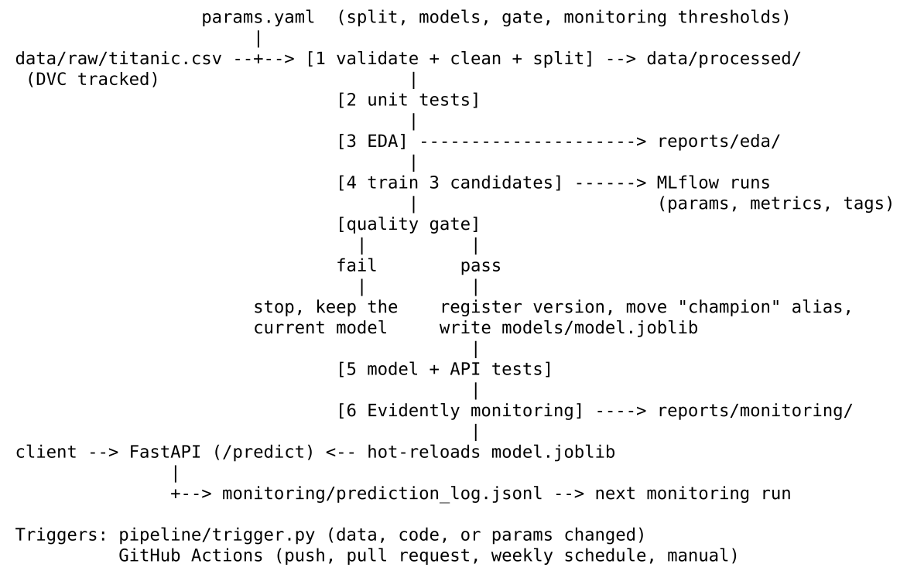
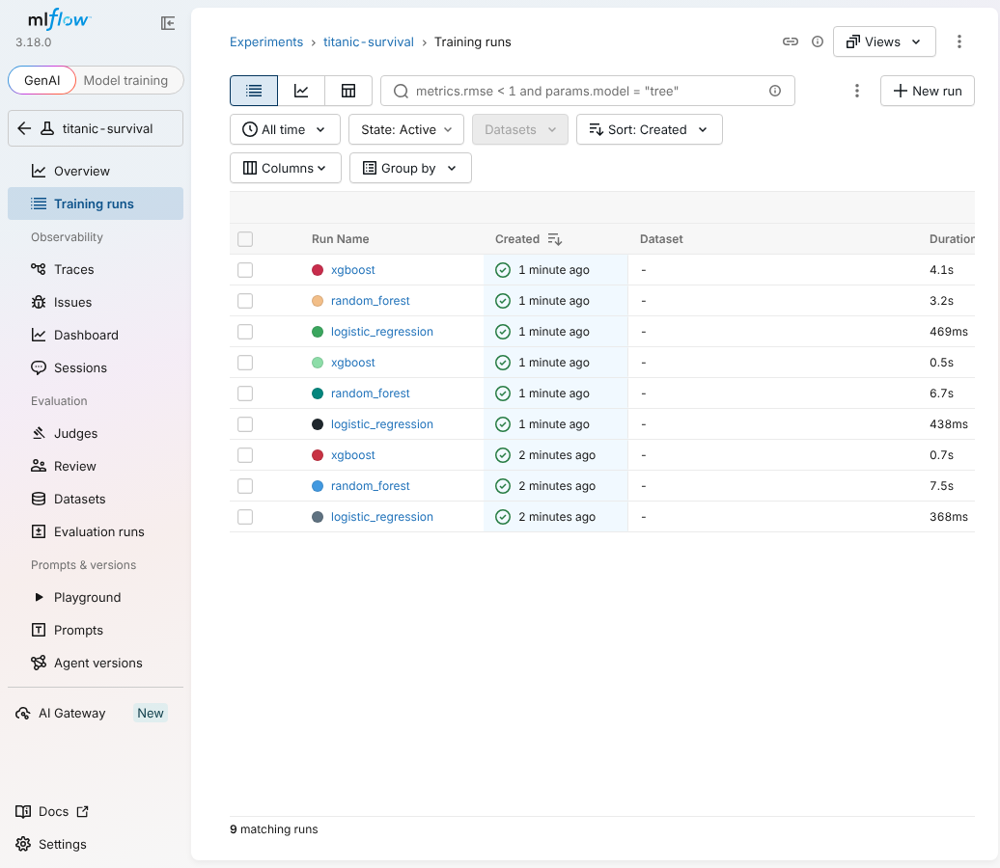
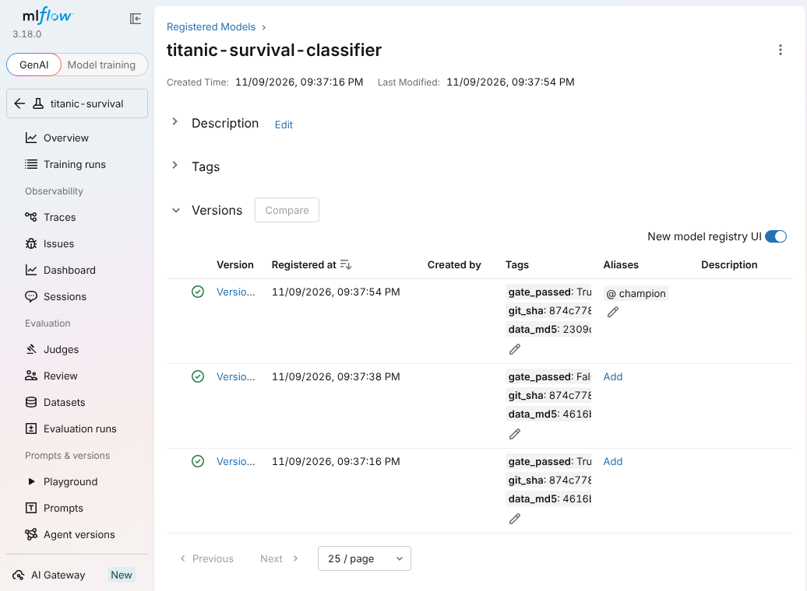
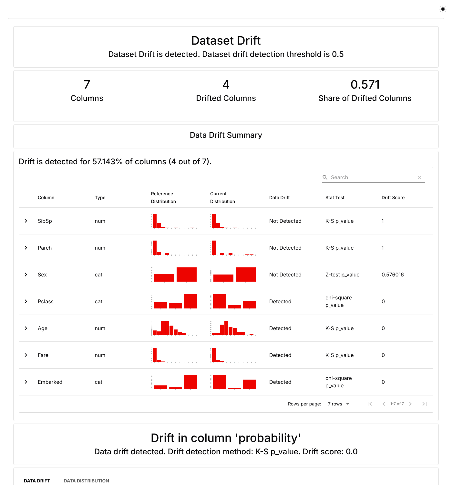

# 1. Project Objectives and Significance

The goal of this project was to build a complete MLOps lifecycle around a classification model: explore and prepare the data, train and evaluate a model, version the data and the model, automate retraining and deployment behind a quality gate, serve predictions through a REST API, and monitor the deployed model for drift.

The assignment scenario is a healthcare analytics team predicting 30-day hospital readmission. The dataset supplied with the assignment is the Titanic passenger dataset (Kaggle, n.d.), so the model in this project predicts the binary target `Survived`, and the "patient records" the API accepts are passenger records. The two problems have the same shape: a binary outcome, a mix of demographic and categorical features, missing values, and a skewed numeric field. Every part of the pipeline carries over to a readmission dataset by changing the column definitions and validation rules.

The significance is in the system more than the model. Sculley et al. (2015) point out that the model code is a small fraction of a production machine learning system, and that most of the risk sits in the surrounding data, configuration, serving, and monitoring. In a clinical setting, a model that is silently retrained on corrupted data, or that keeps serving after the patient population has shifted, can do real harm. This project therefore treats the checks around the model as the main deliverable:

- bad data stops the pipeline before training
- a weaker model cannot replace the one in production
- every prediction traces back to an exact model version, code commit, and data file
- drift in inputs or predictions raises an alert

# 2. Pipeline Architecture and Tool Integration



*Figure 1. Pipeline architecture.*

| Tool | Role in this project |
|---|---|
| pandas, scikit-learn (Pedregosa et al., 2011) | Data handling, preprocessing pipeline, Logistic Regression, Random Forest, metrics |
| XGBoost (Chen & Guestrin, 2016) | Gradient-boosted tree candidate |
| MLflow (MLflow Project, n.d.) | Experiment tracking and the model registry with a `champion` alias |
| DVC (Iterative, n.d.) | Versioning of the raw data and of the pipeline stages and outputs |
| GitPython | Records the commit, branch, and dirty state with every pipeline run |
| pytest | 32 tests across data, features, model, and API |
| FastAPI (Ramírez, n.d.) | REST API with validation and API-key authentication |
| Evidently AI (Evidently AI, n.d.) | Data drift, prediction drift, and performance reports |
| GitHub Actions, Docker | Hosted CI/CD and packaging of the API |

The tools connect through two shared pieces. `params.yaml` is the single source of settings, and DVC tracks it, so changing a threshold invalidates the right stages. The Git commit and the MD5 hash of the raw data are attached to every MLflow run, every registered model version, and every pipeline run record, which ties the four systems (Git, DVC, MLflow, and the API's `/model-info` endpoint) to one lineage.

# 3. Data Exploration and Preprocessing

## 3.1 Exploration

The dataset has 891 rows and 12 columns with no duplicate rows. The positive class (survived) is 38.4%, a moderate imbalance, which is why the evaluation reports precision, recall, F1, and ROC-AUC alongside accuracy.

Three columns have missing values: `Cabin` (687 rows, 77.1%), `Age` (177 rows, 19.9%), and `Embarked` (2 rows, 0.2%).

{width=60%}

*Figure 2. Missing values by column.*

Survival differs sharply across groups: 74.2% of women survived against 18.9% of men, and 63.0% of first-class passengers against 24.2% of third-class. The engineered `Title` feature separates the groups further (Mrs 79.4%, Miss 70.3%, Master 57.5%, Mr 15.7%).


*Figure 3. Survival rate by sex, passenger class, and engineered title.*

`Fare` is strongly right-skewed (skewness 4.79, maximum 512.33). Using the 1.5 x IQR rule, 116 fares sit above the upper fence of 65.63. These are real first-class tickets, not errors, so they were kept and treated instead of dropped.


*Figure 4. Age by outcome, and fare before and after the log transform.*

## 3.2 Cleaning and preprocessing

Preprocessing is split deliberately into two parts.

**Before the split (`src/data.py`).** Only row-level operations that learn nothing from the data: schema and range validation, removal of duplicate IDs, whitespace and case normalisation, and dropping `Ticket` (a near-unique string). The train/test split is keyed on a hash of `PassengerId` (703 train, 188 test). A row stays in the same split on every run, even after new data is appended, which matters for comparing an old model with a new one on the same held-out rows.

**Inside the model pipeline (`src/features.py`).** Everything that learns from data is fitted on the training split only and saved as part of the model, so the API applies the identical transformation:

| Issue | Treatment |
|---|---|
| Missing `Age` | Median imputation, plus an `AgeMissing` flag because missingness is itself informative |
| Missing `Embarked` | Most-frequent imputation |
| Missing `Cabin` | Not imputed. Converted to `HasCabin` (0/1) and `Deck` (first letter, `U` for unknown) |
| Fare skew and outliers | `log1p` transform, then winsorising at the 1st and 99th training percentiles |
| Other numeric outliers | Winsorising at the 1st and 99th training percentiles |
| Categorical variables | One-hot encoding, with unseen categories ignored at prediction time |
| Scale | Standardisation of numeric features (needed for Logistic Regression) |

## 3.3 Feature engineering

| Feature | Definition | Rationale |
|---|---|---|
| `Title` | Honorific parsed from `Name` (Mr, Mrs, Miss, Master, Rare) | Proxy for sex, age group, and social status |
| `FamilySize` | `SibSp + Parch + 1` | Combined family signal |
| `IsAlone` | `FamilySize == 1` | Survival 30.4% alone against 50.6% with family |
| `HasCabin` | Cabin recorded | Survival 66.7% with a cabin record against 30.0% without |
| `Deck` | First letter of `Cabin` | Location on the ship |
| `AgeMissing` | Age was missing | Keeps the information that imputation would erase |
| `FareLog` | `log1p(Fare)` | Reduces skew |

In the final model, the largest feature importances were `Title = Mr` (0.30), `Sex = female` (0.10), `Pclass` (0.07), and `HasCabin` (0.05), so the single strongest signal and one more of the top five are engineered features.

# 4. Model Building and Evaluation

Three algorithms were trained through the same preprocessing pipeline and compared with stratified 5-fold cross-validation on the training split. The candidate with the highest mean cross-validated ROC-AUC is selected. The test split is not used for selection.

| Model | CV ROC-AUC (SD) | CV F1 | Test accuracy | Test precision | Test recall | Test F1 | Test ROC-AUC |
|---|---|---|---|---|---|---|---|
| Logistic Regression | 0.879 (0.026) | 0.786 | 0.825 | 0.809 | 0.733 | 0.769 | 0.841 |
| Random Forest | 0.877 (0.021) | 0.773 | 0.830 | 0.853 | 0.693 | 0.765 | 0.855 |
| **XGBoost (selected)** | **0.882 (0.026)** | 0.765 | **0.835** | **0.855** | 0.707 | **0.774** | 0.849 |

*Table 1. Candidate comparison. Test set n = 188.*

XGBoost was selected and reached 83.5% accuracy, 0.855 precision, 0.707 recall, 0.774 F1, and 0.849 ROC-AUC on the test split. The confusion matrix shows 104 true negatives, 9 false positives, 22 false negatives, and 53 true positives.

{width=45%} {width=45%}

*Figure 5. Confusion matrix and ROC curve for the selected model on the test split.*

Two points deserve an honest reading. First, the three candidates are separated by 0.005 in cross-validated ROC-AUC while the fold-to-fold standard deviation is about 0.02 to 0.03, so they are statistically indistinguishable on this much data. Logistic Regression would be a defensible choice on interpretability grounds. Second, the model is more precise than it is sensitive: it misses 22 of 75 survivors. In the readmission framing, where a missed high-risk patient is the costly error, the 0.5 decision threshold should be lowered to trade precision for recall.

# 5. Model and Data Versioning

**MLflow.** Each candidate is logged as one run with its hyperparameters, cross-validation metrics, test metrics, and tags for the Git commit and data hash. The selected model is logged with its signature and an input example, then registered as a new version of `titanic-survival-classifier`. The alias `champion` marks the version in production.



*Figure 6. MLflow experiment view: three candidate runs for each of three pipeline executions.*



*Figure 7. MLflow model registry. Version 3 holds the `champion` alias. Version 2 is tagged `gate_passed: False` and was never promoted.*

**DVC.** The raw data is tracked through `data/raw/titanic.csv.dvc`, and the four stages (prepare, eda, train, monitor) are declared in `dvc.yaml` with their dependencies, parameters, and outputs. `dvc.lock` stores the hash of every input and output. Running `dvc repro` a second time with nothing changed skipped all four stages and reported "Data and pipelines are up to date," which confirms the dependency tracking works.

Versioning practices followed: data and model binaries stay out of Git and are referenced by hash, every model version carries the commit and data hash that produced it, model versions are immutable and promotion is done by moving an alias, and failed candidates are kept in the registry for audit.

# 6. CI/CD Pipeline

`pipeline/run_pipeline.py` runs six steps and stops at the first failure: validate and prepare data, unit tests, EDA, train with gate and promotion, model and API tests, and monitoring. `pipeline/trigger.py` fingerprints the raw data, `params.yaml`, and the source code, and runs the pipeline only when something changed. The GitHub Actions workflow runs the same pipeline on pushes and pull requests that touch data, code, or parameters, on a weekly schedule, and on demand.

The pipeline was exercised in five scenarios. The full console output of each is in `docs/evidence/`.

| # | Scenario | Result |
|---|---|---|
| 1 | Initial run on the first 800 rows | All steps passed. Random Forest promoted as version 1 (test ROC-AUC 0.842) |
| 2 | Trigger with nothing changed | "No change in data, code, or params. Pipeline not triggered." |
| 3 | `gate.min_roc_auc` raised from 0.80 to 0.95 | Trigger detected the params change. Candidate (ROC-AUC 0.842) failed the gate, was registered as version 2 but not promoted. Serving model file unchanged (checksum verified) |
| 4 | One `Age` value corrupted to -22 | Trigger detected the data change. Validation failed with "Age outside 0 to 120". Pipeline stopped before training. Serving model unchanged |
| 5 | New data arrives (full 891 rows) | Trigger detected the data change. XGBoost promoted as version 3 (test ROC-AUC 0.849) after beating the re-scored version 1 (0.846) on the same test rows |

*Table 2. Pipeline scenarios run for this report.*

```
$ python -m pipeline.trigger   # new data arrives: full 891-row dataset
Change detected in: data. Triggering pipeline.

=== validate_and_prepare_data ===
Validated 891 raw rows. Wrote 703 train and 188 test rows to data/processed.

=== unit_tests ===
14 passed in 0.97s

=== train_gate_and_promote ===
logistic_regression  cv_roc_auc=0.8792 cv_f1=0.7860 test_roc_auc=0.8412 test_f1=0.7692
random_forest        cv_roc_auc=0.8769 cv_f1=0.7725 test_roc_auc=0.8547 test_f1=0.7647
xgboost              cv_roc_auc=0.8819 cv_f1=0.7646 test_roc_auc=0.8485 test_f1=0.7737
Promoted xgboost as version 3 (alias 'champion').

=== model_and_api_tests ===
18 passed in 1.40s

=== monitoring ===
INFO holdout: drift_share=0.0 drifted=[]
INFO simulated_drift: drift_share=0.5714 drifted=['Age', 'Fare', 'Pclass', 'Embarked']

Pipeline succeeded.
```

*Figure 8. Condensed console output of scenario 5.*

Deployment is the last link. Promotion writes `models/model.joblib`, and the running API reloads the file when its modification time changes, so a passing pipeline deploys without a restart and a failing one changes nothing.

# 7. Model Deployment as a REST API

The FastAPI service exposes four endpoints: `GET /health` (open), `POST /predict`, `POST /predict/batch` (up to 500 records), and `GET /model-info` (all three protected by an API key).

```
$ curl -s -X POST http://localhost:8000/predict -H "X-API-Key: $API_KEY" \
    -H "Content-Type: application/json" \
    -d '{"Pclass":1,"Sex":"female","Age":38,"SibSp":1,"Parch":0,"Fare":71.28,
         "Embarked":"C","Name":"Cumings, Mrs. John Bradley","Cabin":"C85"}'
{"survived":1,"survival_probability":0.9773,"risk_level":"low","model_version":3}

$ curl ... -d '{"Pclass":3,"Sex":"male","Age":22,"SibSp":1,"Parch":0,"Fare":7.25,"Embarked":"S"}'
{"survived":0,"survival_probability":0.0428,"risk_level":"high","model_version":3}

$ curl ... (same request without the X-API-Key header)
{"detail":"Invalid or missing API key"}                               HTTP 401

$ curl ... -d '{"Pclass":9,"Sex":"male","Age":-4}'
{"detail":[{"loc":["body","Pclass"],"msg":"Input should be 1, 2 or 3"},
           {"loc":["body","Age"],"msg":"Input should be greater than or equal to 0"}]}   HTTP 422
```

*Figure 9. Requests against the running service (validation messages shortened). Full output is in `docs/evidence/06_api_requests.txt`.*

**Testability.** Eighteen automated tests cover the model artifact and the API: authentication (missing key, wrong key, server with no key configured), a valid prediction, a request with only the required fields, six kinds of invalid input, batch scoring, the batch size limit, and prediction logging. FastAPI also generates interactive documentation at `/docs`.

**Security.** The API key is read from an environment variable and compared in constant time. The service fails closed when no key is configured. Pydantic enforces allowed values, numeric ranges, and string lengths, and rejects unknown fields. Errors return generic messages. The prediction log omits the free-text name field. The container runs as a non-root user.

# 8. Model Monitoring

`src/monitor.py` uses Evidently AI to compare each batch of current data with the training data. It checks data drift per feature (Kolmogorov-Smirnov for numeric features, chi-square or Z-test for categorical features, p < 0.05), drift in the predicted probabilities, and classification performance when labels exist. Three alert rules are configured in `params.yaml`: 30% or more of features drifted, prediction drift, or F1 more than 0.05 below the value recorded at promotion.

| Batch | Rows | Features drifted | Prediction drift | F1 | ROC-AUC | Alerts |
|---|---|---|---|---|---|---|
| Holdout (test split) | 188 | 0 of 7 | No (p = 0.80) | 0.774 | 0.849 | 0 |
| Simulated drift (synthetic) | 188 | 4 of 7 (57%): Age, Fare, Pclass, Embarked | Yes (p < 0.001) | 0.722 | 0.832 | 3 |
| API log (demo traffic) | 122 | 0 of 7 | No (p = 0.91) | no labels | no labels | 0 |

*Table 3. Monitoring results.*

There is no real production traffic for this project, so two of the batches are constructed and labelled as such. The simulated-drift batch is the test split with deliberate shifts (age +15 years, fare x 2.5, half the rows moved to first class, 40% re-embarked at Cherbourg), built to prove the alert path fires. It raised all three alerts: data drift, prediction drift, and a performance drop (F1 from 0.774 to 0.722). The API-log batch is 122 requests replayed from the dataset through the running service, which shows the loop from serving log to drift report working end to end.

{width=85%}

*Figure 10. Evidently report for the simulated-drift batch: 4 of 7 columns drifted.*

The interactive reports are in `reports/monitoring/` (`holdout_report.html`, `simulated_drift_report.html`, `production_report.html`), with `monitoring_summary.json` and `alerts.json` beside them. Running the monitor with `--fail-on-alert` in a scheduled job turns an alert on real data into a failed job.

# 9. Lessons Learned

**A fair comparison between model versions needs a stable test set.** The first version of the quality gate compared a new candidate with the champion after a random re-split. When new rows arrived, the split reshuffled, some rows the old champion had trained on landed in the new test set, and the champion's score was inflated. The gate blocked a legitimate retrain. The fix was a split keyed on a hash of `PassengerId`, so the test set only grows and old and new models are scored on the same unseen rows.

**Preprocessing belongs inside the model artifact.** Putting imputation, outlier caps, encoding, and feature engineering in one scikit-learn pipeline removed a whole class of problems: no leakage from test data into imputation values, and no second implementation of the features in the API.

**On small data, model choice is mostly noise.** The three algorithms were within 0.005 of each other on cross-validated ROC-AUC with a fold standard deviation near 0.025. Time spent on validation, the gate, and monitoring bought more reliability than hyperparameter tuning would have.

**Drift and performance are different signals.** Shifting four of seven features moved F1 by only 0.05, because the strongest predictors (sex and title) were untouched. Data drift is a prompt to investigate, not proof the model is broken, which is why the monitor tracks drift, prediction drift, and performance separately.

**Tool versions matter.** MLflow 3 changed its default model serialisation, and Evidently's API changed substantially at version 0.7. Both needed adjustments, and `requirements.txt` sets version bounds for that reason.

# 10. Future Recommendations

1. **Use a real readmission dataset** and revisit the decision threshold with clinicians, since a missed high-risk patient costs more than a false alarm. Add calibration checks, because a risk score is only useful if 30% means 30%.
2. **Audit fairness.** Sex and class dominate this model. A clinical model needs performance broken out by demographic group before deployment.
3. **Move shared state off the laptop.** Run an MLflow tracking server and a DVC remote on object storage so the registry and data are shared and backed up.
4. **Deploy gradually.** Add a staging alias and shadow or canary releases, so a new version is compared with the champion on live traffic before taking over.
5. **Close the label loop.** Join delayed ground-truth labels to the prediction log so production performance is measured directly instead of inferred from drift.
6. **Harden the API.** TLS, per-client keys or OAuth, rate limiting, audit logs, and secrets from a vault.
7. **Wire alerts to people.** Send `alerts.json` to email or chat, and store Evidently snapshots over time for trend dashboards.

# References

Chen, T., & Guestrin, C. (2016). XGBoost: A scalable tree boosting system. In *Proceedings of the 22nd ACM SIGKDD International Conference on Knowledge Discovery and Data Mining* (pp. 785–794). Association for Computing Machinery. https://doi.org/10.1145/2939672.2939785

Evidently AI. (n.d.). *Evidently documentation*. https://docs.evidentlyai.com

Iterative. (n.d.). *DVC documentation*. https://dvc.org/doc

Kaggle. (n.d.). *Titanic: Machine learning from disaster* [Data set]. https://www.kaggle.com/c/titanic

MLflow Project. (n.d.). *MLflow documentation*. https://mlflow.org/docs/latest/

Pedregosa, F., Varoquaux, G., Gramfort, A., Michel, V., Thirion, B., Grisel, O., Blondel, M., Prettenhofer, P., Weiss, R., Dubourg, V., Vanderplas, J., Passos, A., Cournapeau, D., Brucher, M., Perrot, M., & Duchesnay, É. (2011). Scikit-learn: Machine learning in Python. *Journal of Machine Learning Research, 12*, 2825–2830.

Ramírez, S. (n.d.). *FastAPI documentation*. https://fastapi.tiangolo.com

Sculley, D., Holt, G., Golovin, D., Davydov, E., Phillips, T., Ebner, D., Chaudhary, V., Young, M., Crespo, J.-F., & Dennison, D. (2015). Hidden technical debt in machine learning systems. *Advances in Neural Information Processing Systems, 28*, 2503–2511.
